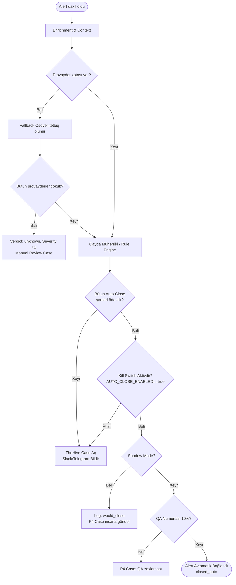

# ADR-0002: Səhv Qərar Riski (FN) və Fallback Siyasəti

* **Status:** Proposed
* **Tarix:** 2026-10-27
* **Müəllif:** Komanda
* **Task:** Phase 1 · Task 1.6 (Runbook)

---

## 1. Kontekst və Riskin Asimmetriyası
SOC mühitində iki növ səhv mövcuddur:
* **FP (False Positive - Boş həyəcan):** Zərərsiz bir hadisə insana göndərilir. Analitikin cəmi 1–2 dəqiqəsini alır.
* **FN (False Negative - Zərərli alert-in bağlanması):** Real kiberhücum avtomatik bağlanır və gözdən qaçır. Bu, şirkət üçün kritik təhlükəsizlik insidentidir.

**Əsas prinsip:** Risklər bərabər deyil. Sistem hər hansı bir şübhədə, çatışmazlıqda və ya xətada alert-i bağlamır, mütləq **insana (fail-safe)** göndərir.

---

## 2. Əsas Prinsiplər
1. **Fail-safe (Həmişə təhlükəsiz tərəf):** Şübhə varsa → `P4 Case` yaradılır və insana ötürülür. Fail-open (xəta zamanı avtomatik bağlama) qəti qadağandır.
2. **Alert heç vaxt itmir:** Hər alert mütləq 3 sonluqdan birinə çatmalıdır: `case`, `closed_auto` və ya `DLQ` (Dead Letter Queue).
3. **Məlumat azaldıqca konservatizm artır:** Kəşfiyyat (intel) məlumatı azaldıqca sistem daha ehtiyatlı davranır.

---

## 3. Auto-Close Meyarları
Sistem alert-i **YALNIZ VƏ YALNIZ** aşağıdakı bütün şərtlər eyni anda ödəndikdə avtomatik bağlaya (`closed_auto`) bilər:
* `verdict == clean` (Bütün mənbələr təmiz deyir)
* `confidence ≥ 0.67` (Gözlənilən intellekt mənbələrinin ən azı 2/3-ü uğurla cavab verib)
* `conflict == false` (Mənbələr arasında ziddiyyət yoxdur)
* `enrichment.status == ok` (Zənginləşdirmə tam uğurla başa çatıb)
* İstifadəçi imtiyazlı (Domain Admin, VIP və s.) deyil.
* Asset kritik (`crown_jewel` server, DC və s.) deyil.

---

## 4. Əlavə Qoruyucular (Safety Guards)
* **Shadow Mode:** İlkin mərhələdə sistem auto-close qərarı versə belə, alert real olaraq bağlanmır. Log-a yazılır və insana `P4` kimi göndərilir.
  * *Shadow rejimindən çıxış:* Dataset üzərində `FN = 0` və QA yoxlamasında 0 xəta olduqda.
* **QA Nümunəsi:** Avtomatik bağlanan alert-lərin təsadüfi **10%-i** keyfiyyətə nəzarət üçün L1 analitikinə göndərilir.
* **Kill Switch:** `AUTO_CLOSE_ENABLED=false` mühit parametri vasitəsilə heç bir kodu dəyişmədən avtomatik bağlama dərhal söndürülə bilir.

---

## 5. Fallback Cədvəli (9 Vəziyyət)

| # | Vəziyyət | Sistem Davranışı | Səbəb |
|---|---|---|---|
| 1 | **Bir provayder 429 (Rate limit)** | Token gözlənilir (maksimum 60 saniyə), sonra `skipped`, status `partial` | Alert sonsuz növbədə ilişib qalmamalıdır |
| 2 | **5xx və ya Timeout** | 3 dəfə retry (backoff 1–2–4 saniyə + jitter), sonra `skipped` | Şəbəkə və servis xətaları çox vaxt müvəqqətidir |
| 3 | **Ardıcıl 5 xəta** | Circuit breaker açılır, 60 saniyə həmin servisə sorğu atılmır | Çökmüş və ya donmuş servisə vaxt itirmirik |
| 4 | **Bütün provayderlər əlçatmazdır** | Verdict `unknown`, severity `+1`, auto-close qadağandır, case "manual review" açılır | Fail-safe: intel yoxdursa insan baxmalıdır |
| 5 | **401 / 403 (Səlahiyyət xətası)** | Retry yoxdur, provayder söndürülür, kritik bildiriş göndərilir | API açarı və ya abunəlik xətası öz-özünə düzəlməyəcək |
| 6 | **Redis əlçatmazdır** | Yaddaşdaxili (in-memory) cache rejiminə keçilir, xəbərdarlıq log-u atılır | Cache-in itməsi qərara yox, yalnız icra sürətinə təsir edir |
| 7 | **TheHive əlçatmazdır** | Case sorğusu DLQ-ya yönləndirilir, bildiriş "case pending" qeydi ilə gedir | SOC komandası yeni insidentdən xəbərsiz qalmasın |
| 8 | **Slack / Telegram əlçatmazdır** | Email fallback işə düşür, göndərilə bilməyən mesaj DLQ-ya atılır | Bildiriş kanalı tək nasazlıq nöqtəsi (SPOF) olmamalıdır |
| 9 | **partial alert** | 15 dəqiqədən bir yenidən enrichment yoxlanışı edilir; nəticə dəyişərsə case-ə qeyd yazılır | Gecikmiş və ya sonradan açılan məlumatlar itməsin |

---

## 6. Qərar Ağacı (Decision Tree)

