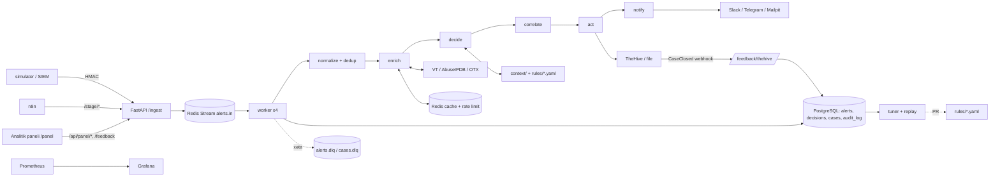

# Arxitektura

Bu sənəd sistemi dəyişəcək proqramçı üçündür: komponentlər, məlumat axını, məlumat modeli, qərar məntiqi və dayanıqlılıq. Əməliyyat əmrləri üçün: [`operations.md`](operations.md).

## Diaqram



## Komponentlər

**Ingest API** (`app/main.py`). `POST /ingest/{wazuh|edr|proxy}` gövdəni HMAC-SHA256 imzası ilə yoxlayır (`X-Signature`), 256 KB-dan böyük gövdəni rədd edir (413), alert-i Redis Stream-ə (`alerts.in`) yazır və dərhal `202` qaytarır. Qəbul anı (`received_at`) MTTR-in başlanğıcıdır. Admin endpoint-ləri (`/dlq`, `/alerts/{id}/timeline`, `/stage/*`, `/feedback`) `X-Admin-Token` tələb edir.

**Worker** (`app/worker.py`). `pipeline` consumer group-u ilə stream-dən oxuyur, eyni anda 4 alert emal edir. Mesaj yalnız emal bitəndən sonra ACK olunur. 60 s-dən çox ACK olunmayan mesajı başqa consumer götürür (reclaim). 3 uğursuz cəhddən sonra mesaj `alerts.dlq`-ya düşür. Fon tapşırıqları: hər 2 dəqiqədə gözləyən case-lər yenidən yaradılır və DLQ dərinliyi metrikaya yazılır; hər 15 dəqiqədə `partial`/`failed` alert-lər yenidən enrich olunur.

**Normalize** (`app/normalize/`). Hər mənbənin parser-i alert-i vahid modelə (`NormalizedAlert`, OCSF Detection Finding) çevirir: IOC-lar çıxarılır, refang olunur (`hxxp` → `http`), daxili IP-lər işarələnir (intel-ə göndərilmir). Fingerprint alert tipi və IOC-lardan hesablanır (host daxil deyil). Eyni fingerprint 15 dəqiqə ərzində təkrar gəlsə, yeni sətir yaranmır, `occurrence_count` artır.

**Enrich** (`app/enrich/`). Hər xarici IOC VirusTotal, AbuseIPDB (yalnız IP) və OTX-də yoxlanılır. Qorunma qatları:

| Qat | Dəyər |
|---|---|
| Timeout və retry | 8 s, 3 cəhd, backoff |
| Circuit breaker | 5 ardıcıl xəta → 60 s açıq; 401-də provider söndürülür |
| Rate limit (token bucket, Redis Lua) | VT dəqiqədə 4 × 0.9; növbədə 60 s-dən çox gözləyən → `rate_limited` |
| Cache (Redis) | malicious 24 saat, clean 6 saat, suspicious/unknown/not_found 1 saat |

Nəticələr `rules/weights.yaml` ilə birləşdirilir: güclü mənbələrin (VT, AbuseIPDB) maksimumu və çəkili ortalama qarışdırılır. "clean" üçün hər IOC güclü mənbədə **tapılmalı** və cavabların ən az 2/3-i gəlməlidir: heç kimin tanımadığı IOC təmiz deyil, `unknown`-dur.

**Decide** (`app/rules/`). Üç qat:

1. **Qaydalar** (`rules/severity.yaml`): yuxarıdan aşağı, ilk uyğun gələn qayda verdict, severity və hərəkəti (`create_case` / `auto_close`) təyin edir. Fayl dəyişəndə restart lazım deyil (mtime ilə yenidən oxunur).
2. **Qoruyucular** (`app/rules/guards.py`, ADR-0002, ADR-0003): qayda "bağla" desə də, bu hallarda case açılır: intel `malicious`, enrichment natamam, etibarlılıq < 0.67, mənbələr ziddiyyətli, imtiyazlı/VIP istifadəçi, `crown_jewel` asset, dynamic DNS domeni. İnsanın təsdiqlədiyi allowlist bəzi qoruyucuları keçir, `malicious`-u heç vaxt.
3. **Kill switch və shadow mode**: `AUTO_CLOSE_ENABLED=false` və ya `SHADOW_MODE=true` olanda qoruyuculardan keçən "bağla" qərarı da case-ə çevrilir, qeyddə "sistem bağlayardı" yazılır.

Prioritet severity və kontekstdən hesablanır: kritik (severity 5) və ya yüksək + imtiyazlı/kritik asset → P1; yüksək → P2; orta → P3; qalan → P4.

**Correlate** (`app/correlation/`, `rules/correlation.yaml`). Redis-də IOC, istifadəçi və host üzrə son 24 saatın case indeksi saxlanılır:

| Qayda | Şərt | Nəticə |
|---|---|---|
| C1 | Eyni IOC artıq açıq case-dədir | Yeni case yox, mövcud case-ə əlavə (`case_linked`) |
| C2 | Eyni istifadəçidə başqa tipli case var | Severity +1 |
| C3 | Eyni host-da hash + URL zənciri (clean olmayan) | Severity ən az CRITICAL (P1) |
| C4 | Eyni /24 şəbəkəsindən 60 dəqiqədə ≥ 5 login | Brute-force case-inə əlavə |

**Act** (`app/pipeline.py`, `app/case/`). `create_case`: TheHive və ya fayl backend-ində case (başlıqda IOC defang olunur: `hxxp://bad[.]example`). Eyni fingerprint üçün 24 saatda bir case (idempotentlik). Backend əlçatmazdırsa alert `case_pending` olur və `cases.dlq`-ya düşür; housekeeping onu sonra yaradır. `auto_close`: alert `closed_auto`, onların 10%-i QA üçün P4 case kimi insana gedir.

**Notify** (`app/notify/`). Yalnız P1 və P2: Slack və Telegram; P1 üçün həmişə, chat alınmayanda isə email (Mailpit). Throttle: eyni fingerprint üçün P1 15 dəqiqədə, P2 1 saatda bir dəfə.

**Audit** (`app/audit/`). Hər mərhələ `audit_log`-a yazılır. Hər sətir əvvəlki sətrin hash-ını saxlayır (hash zənciri); `UPDATE`/`DELETE` trigger ilə qadağandır. Yoxlama: `python -m tools.verify_audit`. Loglarda secret maskalanır.

**Rəy dövrəsi** (`app/feedback/`, `tools/tuner.py`, `tools/replay.py`). TheHive-da case bağlananda `CaseClosed` webhook-u `/feedback/thehive`-a gəlir (Bearer token) və analitikin verdict-i `feedback` cədvəlinə yazılır. Tuner rəylərdən qayda/çəki təklifi hazırlayır, replay təklifi keçmiş alert-lər üzərində sınayır (safety gate: FN artmamalıdır). Təklif ayrıca branch-a commit olunur, production-u yalnız insanın merge etdiyi PR dəyişir.

**Analitik paneli** (`app/panel/`). `/panel/` brauzer səhifəsi (HTML, CSS, JS; kitabxana və build addımı yoxdur) və `/api/panel/*` oxuma API-si (admin token). Dashboard (açıq case, P1, son 24 saat, qəbul → case median/p90, saatlıq qrafik), filtr və axtarış (parametrli sorğular, bağlı siyahılar), açıq alert-ləri, sistemin qərarını və səbəblərini, intel mənbə kartlarını (IOC-lar defang), mərhələ vaxtlarını və əlaqəli alert-ləri göstərir; System bölməsi (auto-close/shadow, intel mənbələrinin son 15 dəqiqəlik vəziyyəti, kvota, növbə, DLQ) və Rules bölməsi (qayda üzrə razılaşma, ADR-0003 shadow review irəliləyişi) var; "Təsdiqlə" və "Rədd et" düymələri mövcud `POST /feedback` endpoint-i ilə rəy yazır, yəni tuner və replay panel rəylərini TheHive rəyləri kimi görür. Səhifə sərt CSP ilə verilir (yalnız öz fayllarını yükləyir), alert mətni yalnız `textContent` ilə yazılır, token yalnız brauzer sekməsində saxlanılır.

**n8n** (`n8n/`). Pipeline-ın vizual variantı: eyni mərhələləri `/stage/{normalize,enrich,decide,act,notify}` endpoint-ləri ilə çağırır. Xəta workflow-u Mailpit-ə email göndərir. Əsas yol worker-dir; n8n demo və alternativ orkestrasiya üçündür (ADR-0001).

**Müşahidə** (`app/audit/metrics.py`). Prometheus metrikaları: `alert2case_alerts_total`, `alert2case_duplicates_total`, mərhələ vaxtları, qəbul → hərəkət vaxtı, intel nəticələri (provider, status, cache), bildirişlər, DLQ dərinliyi. API `/metrics`, worker `:9100`. Grafana paneli `grafana/`-dadır (`make up-obs`).

## Məlumat modeli

| Cədvəl | Nə saxlayır |
|---|---|
| `alerts` | `NormalizedAlert` (jsonb `doc`), status, fingerprint, `occurrence_count`, `received_at`, `last_seen` |
| `decisions` | verdict, severity, priority, action, qayda və versiyası, səbəblər (jsonb), `shadow` |
| `cases` | backend, case ID, URL |
| `case_links` | korrelyasiya ilə case-ə bağlanan alert-lər |
| `feedback` | analitikin verdict-i, mənbə (TheHive / manual) |
| `audit_log` | `ts`, `correlation_id` (alert ID), stage, event, payload, `prev_hash`, `row_hash` (append-only) |

Alert statusları: `received` → `enriched` → `decided` → `case_created` / `case_linked` / `case_pending` / `closed_auto`.

`NormalizedAlert` (`app/schemas/alert.py`, JSON Schema: `schemas/`): `alert_id`, `source_system`, `source_ref`, `alert_type` (`malicious_hash`, `suspicious_url`, `suspicious_login`), `time`, `received_at`, `user`, `host`, `observables[]` (type, value, role, internal), `fingerprint`, `context`, `enrichment`, `decision`, `raw`.

## Dayanıqlılıq (ADR-0002)

| Nə baş verir | Sistem nə edir |
|---|---|
| Intel mənbəyi yavaşdır / çöküb | timeout → retry → breaker; enrichment `partial`/`failed` → case açılır (fail-safe), 15 dəqiqədən sonra yenidən enrich |
| VT limiti dolub | növbə; 60 s-dən çox → `rate_limited`, alert bağlanmır |
| Worker emal zamanı çöküb | mesaj ACK olunmayıb → 60 s sonra reclaim |
| Emal 3 dəfə uğursuz | `alerts.dlq`; `POST /dlq/replay` |
| TheHive əlçatmazdır | `case_pending`, `cases.dlq`; housekeeping 2 dəqiqədən bir yenidən sınayır |
| Redis əlçatmazdır | ingest 500 qaytarır (göndərən təkrar etməlidir; [resilience.md](resilience.md), məhdudiyyət 1) |

İnvariant: hər alert üç sonluqdan birinə çatır: case, `closed_auto` və ya DLQ. Ətraflı chaos testləri: [`resilience.md`](resilience.md).

## Qərarlar (ADR)

| ADR | Qərar |
|---|---|
| [0001](adr/0001-platform-selection.md) | Orkestrasiya: Python (FastAPI + Redis Streams + öz qayda mühərriki); n8n vizual alternativ kimi |
| [0002](adr/0002-fn-risk-and-fallback.md) | FN riski asimmetrikdir: şübhədə insana; auto-close meyarları, shadow mode, QA nümunəsi |
| [0003](adr/0003-auto-close-decision.md) | Auto-close hələ açılmır; dynamic DNS qoruyucusu; açılma şərtləri |

## Kodun quruluşu

```
app/
  main.py          ingest, admin endpoint-ləri
  worker.py        stream consumer, reclaim, housekeeping
  pipeline.py      normalize → enrich → decide → correlate → act → notify
  normalize/       parser-lər, IOC çıxarma, fingerprint
  enrich/          provider-lər, http (retry), breaker, ratelimit, cache, aggregate, reenrich
  context/         asset, istifadəçi, allowlist (context/)
  rules/           qayda mühərriki, qoruyucular
  correlation/     C1–C4
  case/            TheHive və fayl backend-i, defang
  notify/          Slack, Telegram, email, throttle
  feedback/        TheHive webhook, rəy
  panel/           analitik paneli: /api/panel/* və statik səhifə
  audit/           hash zənciri, log maskası, metrikalar
rules/             severity.yaml, weights.yaml, correlation.yaml
context/           assets.csv, identities.csv, allowlist.yaml
tools/             simulator, ölçmə, replay, tuner, yoxlama skriptləri
tests/unit, tests/e2e
```
