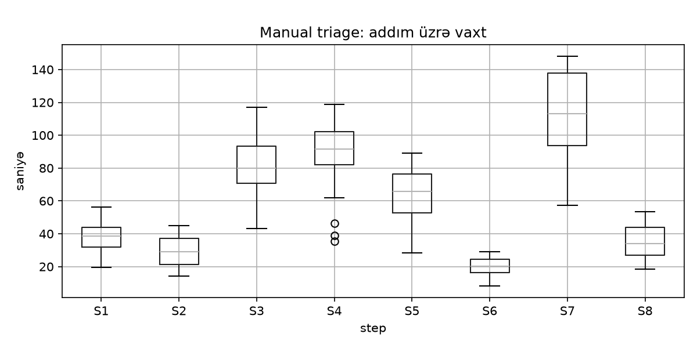

# Baseline: manual L1 triage

## Metod
- 12 alert (HASH×4, NET×4, WEB×4); hər növdə 2 zərərli, 1 təmiz, 1 qeyri-müəyyən
- 2 analitik, hər biri 12 alert-in hamısını təsadüfi sırada emal edib (blind test: kartları hazırlayanlar ölçülməyib)
- 8 addım (S1–S8), hər addımın başlanğıc və bitmə sərhədi əvvəlcədən razılaşdırılıb
- Alət: `tools/timer.py` · Tarix: 28–29.10.2026
- Xam məlumat: `baseline_raw.csv` (192 sətir), orijinallar `raw/`-da; düzgün cavablar: `answers.csv`
- Hesabat: `python tools/baseline_report.py` → `report_output.md`, `steps_boxplot.png`

## Nəticələr

### Manual MTTR (alert başına, saniyə)
| Alert növü | n | Median | p90 |
|---|---:|---:|---:|
| HASH | 8 | 512 (8.5 dəq) | 540 |
| NET | 8 | 481 (8.0 dəq) | 548 |
| WEB | 8 | 485 (8.1 dəq) | 536 |

Bütün alert-lər üzrə median: **≈ 8.3 dəqiqə**. Alert növləri arasında əhəmiyyətli fərq yoxdur.

### Addım üzrə vaxt
| Addım | Median (san) | Vaxt payı |
|---|---:|---:|
| S1 Alert-i oxumaq | 38.6 | 8.2% |
| S2 IOC-ları çıxarmaq | 29.2 | 6.2% |
| S3 VirusTotal | 79.8 | 17.6% |
| S4 AbuseIPDB / OTX | 91.5 | 18.6% |
| S5 Verdict | 65.7 | 13.9% |
| S6 Priority | 20.3 | 4.3% |
| S7 Ticket | 113.3 | 23.8% |
| S8 Komandaya mesaj | 34.0 | 7.5% |

### Qərarların keyfiyyəti
| Göstərici | Nəticə |
|---|---|
| Manual dəqiqlik (hər iki analitik) | **50%** (24 qərardan 12-si düzgün) |
| Analitiklər arası uyğunsuzluq | **100%** (12 alert-in hamısında fərqli verdict) |

Qarışıqlıq cədvəli (sətir: düzgün cavab, sütun: analitikin cavabı, hər iki analitik birlikdə):

| | clean | malicious | suspicious |
|---|---:|---:|---:|
| **clean** | 3 | 0 | 3 |
| **malicious** | 0 | 6 | 6 |
| **suspicious** | 0 | 3 | 3 |

- Heç bir zərərli alert `clean` adlandırılmayıb (false negative yoxdur).
- Səhvlərin hamısı "bir pillə" səhvdir: zərərli → suspicious (6), təmiz → suspicious (3), suspicious → malicious (3).
- `suspicious` ən çox seçilən cavabdır: analitik əmin olmayanda bu kateqoriyaya keçir.

## Avtomatlaşdırma üçün nəticə
- **S3 + S4 (intel yoxlaması) vaxtın 36%-i** → enrichment modulu (Phase 3): eyni sorğular paralel və cache ilə saniyələr içində.
- **S7 + S8 (ticket və mesaj) vaxtın 31%-i** → case və bildiriş (Phase 4).
- **S5 (verdict) 14% və 100% uyğunsuzluq** → qərar qaydaları (Phase 4) vahid və təkrarlanan meyar verir. Sərhəd halları üçün qayda: mənbələr ziddiyyətli və ya az məlumat varsa `suspicious`, insana göndər (ADR-0002).
- Avtomatlaşdırma ilə ümumi qazanc potensialı: alert başına 8 dəqiqədən saniyələrə.

## Məhdudiyyətlər
- Kiçik nümunə: 12 alert × 2 analitik. Nəticələr istiqamət göstərir, statistik cəhətdən güclü deyil.
- Analitiklər tələbədir, real SOC təcrübəsi yoxdur; Hawthorne effekti (ölçüldüyünü bilmək) mümkündür.
- Ölçmə iki gündə aparılıb (28–29.10); CSV faylları təhlildən əvvəl vahid formata salınıb (məlumat dəyişdirilmədən), orijinallar `raw/`-dadır.
- S7-də ticket hazırlanıb, amma Issue-lar ortaq repo-da açılmayıb; S7 vaxtı ticket hazırlamağın vaxtı kimi götürülür.
